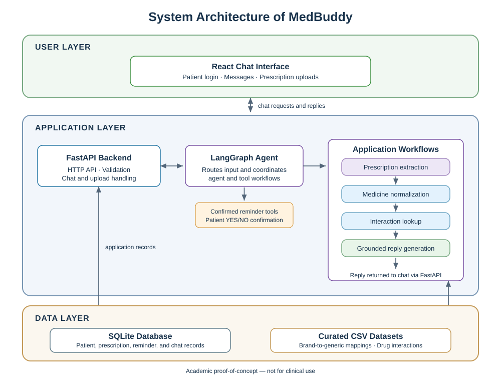
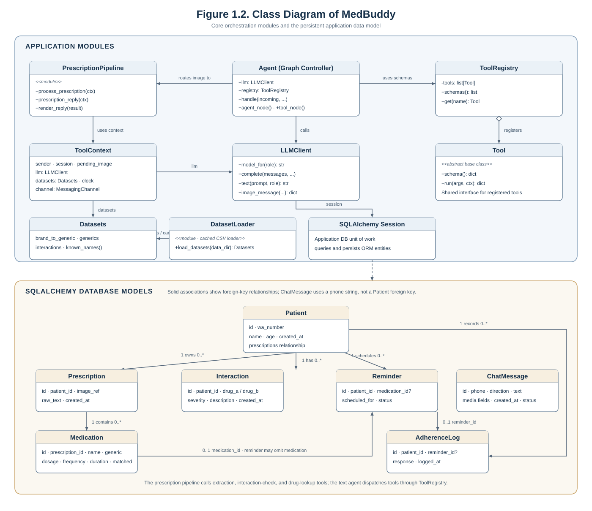
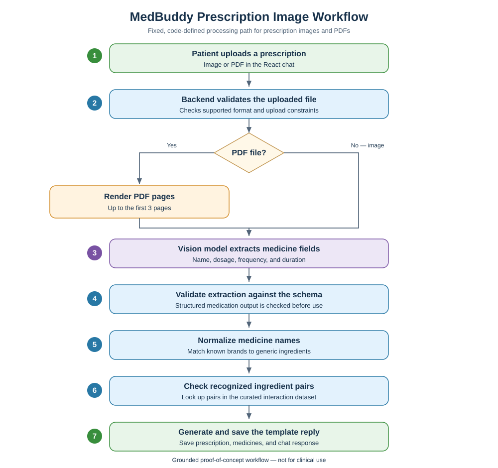
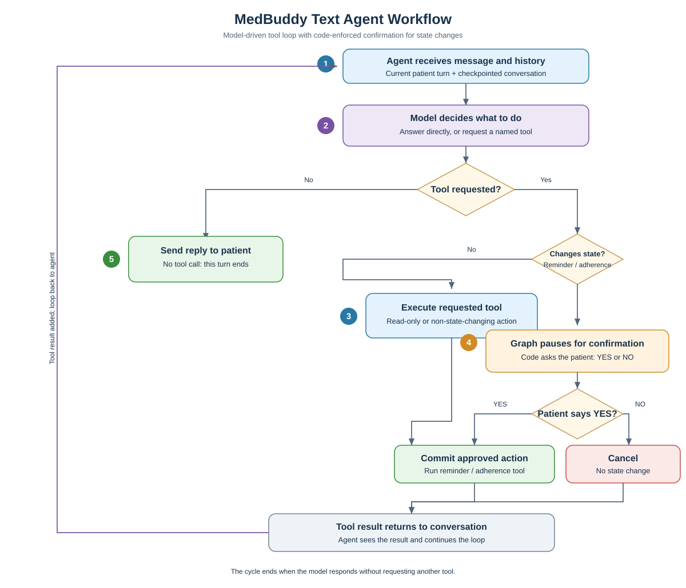
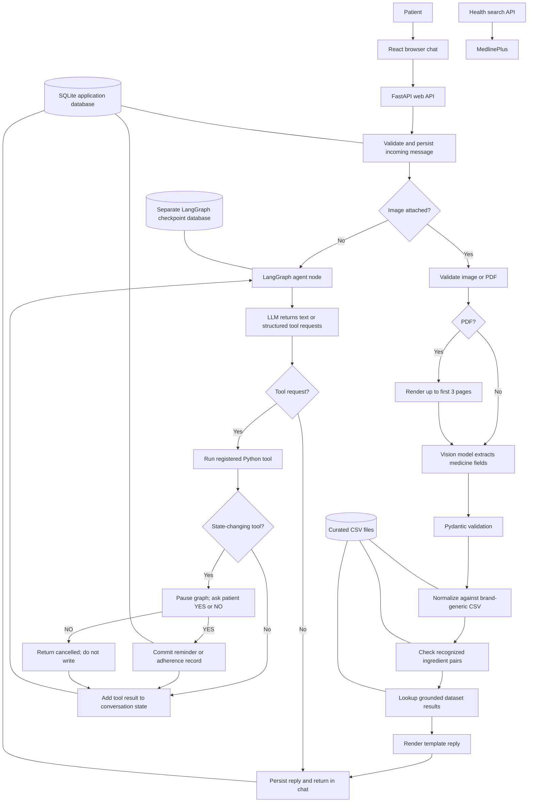

# Architecture and Methodology

## Architecture decision

MedBuddy uses a **hybrid LangGraph architecture**:

- Prescription images enter a fixed, code-defined pipeline.
- Text messages enter a model-driven tool-use loop.
- State-changing reminder and adherence tools pause for explicit patient confirmation.

It is not a fully agentic prescription-processing system. Keeping the photo path fixed
makes the sequence of extraction, normalization, interaction lookup, and reply rendering
predictable and testable.

## System architecture

Figure 1.1 shows MedBuddy's three layers: the React chat interface, the FastAPI and
LangGraph application workflows, and the SQLite database with curated CSV datasets.
The application layer routes requests through prescription processing or agent tools,
including confirmed reminders, and returns replies to the chat.

*Figure 1.1. System Architecture of MedBuddy.*

The editable Mermaid source for the figure is
[system-architecture.mmd](./diagrams/system-architecture.mmd).

## Class diagram

Figure 1.2 summarizes the key application modules and their dependencies, along with
the SQLAlchemy entities and their foreign-key relationships.

*Figure 1.2. Class Diagram of MedBuddy.*

The editable Mermaid source is [class-diagram.mmd](./diagrams/class-diagram.mmd).
The `PrescriptionPipeline` and `DatasetLoader` are Python modules rather than
instantiable classes; they are marked as modules in the diagram. `ChatMessage` is
associated to a patient by phone value and has no patient foreign key.

## Prescription image workflow

Figure 1.3 shows the fixed image-processing path, including the PDF-only rendering
branch before vision extraction.

*Figure 1.3. MedBuddy Prescription Image Workflow.*

The editable Mermaid source is
[prescription-workflow.mmd](./diagrams/prescription-workflow.mmd).

## Text-agent workflow

Figure 1.4 shows the agent's message/tool cycle. Read-only tool results return to the
agent directly; reminder and adherence actions pause for explicit YES/NO confirmation
before the action is committed or cancelled.

*Figure 1.4. MedBuddy Text Agent Workflow.*

The editable Mermaid source is
[text-agent-workflow.mmd](./diagrams/text-agent-workflow.mmd).

## Methodology diagram

## Image-processing path

1. The web API accepts a JPEG, PNG, WebP, or PDF within the configured upload limit.
2. A PDF is rendered into PNG images for up to the first three pages. Additional pages
   are skipped and reported.
3. The graph routes an image to `prescription_node`, not to the general chat agent.
4. The extraction tool sends the image directly to the configured vision model and
   validates the returned medication list with Pydantic.
5. Each medicine name is matched using the local brand/generic dataset. Unmatched names
   remain unknown rather than being described from model knowledge.
6. Recognized generic ingredients are compared pairwise against the interaction CSV.
7. The result is rendered from a template. The default photo mode makes one model call
   for extraction. Optional `PHOTO_REPLY_MODE=rephrase` adds a constrained rephrasing
   call; the original template is retained if rephrasing fails or omits required
   medicine/warning details.
8. The extracted prescription and medications are stored in the application database;
   the response is persisted as a chat message.

There is a separate `run_ocr` tool exposed to the text agent, but automatic prescription
image processing does not run a separate Tesseract/OCR stage.

## Text-agent path

1. The graph receives the patient message and checkpointed conversation history.
2. The agent node sends supported conversation messages and registered tool schemas to
   the LLM through LiteLLM.
3. The model either returns a user-facing response or structured tool requests.
4. The tool node resolves each requested name through `ToolRegistry`, executes it, and
   adds the result to the conversation as a tool message.
5. The graph cycles back to the agent node until the model responds without a tool call,
   or the graph pauses at an interrupt.

The registered tools are `run_ocr`, `extract_medications`, `normalize_drug`,
`check_interactions`, `lookup_drug_info`, `schedule_reminder`, `log_adherence`,
`register_patient`, and `get_my_meds`.

## Confirmation and persistence

`schedule_reminder` and `log_adherence` are the state-changing tools. The graph calls
`interrupt()` before running them, displays the proposed action, and resumes with the
patient's reply. YES commits; NO returns a cancelled result without writing the proposed
change.

Application records use the configured SQLAlchemy database (SQLite by default).
LangGraph conversation checkpoints are kept in a separate SQLite file so chat-state
resetting is separate from application records.

## Data sources and interpretation

- `brand_generic.csv` maps known brand/product names to generic ingredient names.
- `interactions.csv` stores pair names, severity, description, and source.
- The 503 added DDInter-derived pairs provide a DDInter 2.0 risk category and a neutral
  consultation message, not a verified pair-specific mechanism or clinical management
  recommendation.
- The current CSV has 560 unique pairs in total, including the 503 DDInter-derived rows;
  the downloaded file is the ATC-A subset, not the complete DDInter database.
- The interaction dataset is incomplete. No match must never be presented as proof of
  safety.
- MedlinePlus search is an independent general health-topic feature; it is not used as
  the source for medication interaction checks.

## Key code locations

- `medbuddy/agent/loop.py` — graph routing, agent/tool loop, interrupt and checkpoint
  behavior.
- `medbuddy/agent/prescription.py` — fixed image pipeline and template reply.
- `medbuddy/agent/registry.py` — tool registry and schema exposure.
- `medbuddy/tools/` — extraction, normalization, interaction, lookup, profile, reminder,
  and adherence tools.
- `medbuddy/api_web.py` — HTTP endpoints and web message dispatch.
- `medbuddy/db/models.py` — SQLAlchemy entities.
- `medbuddy/datasets/loaders.py` — CSV loading into in-memory structures.
