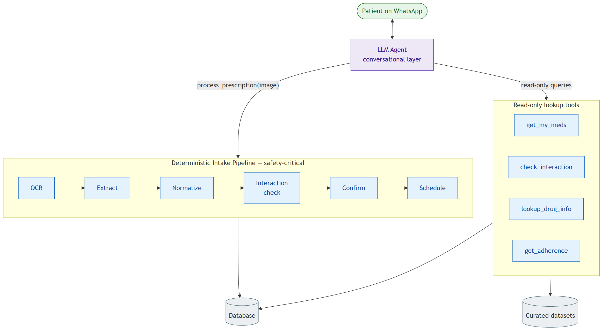
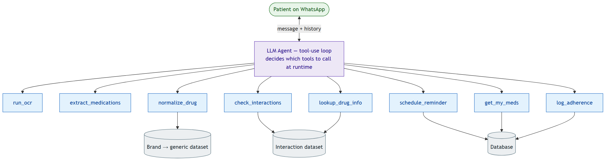

# MedBuddy
### A WhatsApp-Based Medication Adherence & Drug-Interaction Assistant
**Project Design Document — for review by the Faculty Guide**

| | |
|---|---|
| **Institution** | Kalinga Institute of Industrial Technology (KIIT University) |
| **Course** | Minor Project (5 credits) |
| **Team** | Prangshu [Roll No. ____] · Arundhati [Roll No. ____] |
| **Faculty Guide** | [Prof. ____] |
| **Duration** | 1 month |
| **Status** | Proof-of-Concept |
| **Date** | August 2026 |

> **Disclaimer:** MedBuddy is an academic proof-of-concept built for learning and demonstration. It is **not a certified medical device and must not be used for real clinical decision-making.** All drug information is drawn from a small, curated, static dataset. Every user-facing message carries this disclaimer.

---

## Executive Summary

> **For readers short on time — this section summarises the entire project.**

**MedBuddy** is a proof-of-concept WhatsApp assistant that turns a **photo of a prescription** into three things: plain-language explanations of each medicine, **drug-drug interaction warnings**, and automated **dose reminders** with adherence tracking — all with **zero app installation**.

| Aspect | Summary |
|---|---|
| **What it is** | A WhatsApp bot for medication adherence and drug-interaction safety |
| **Target users** | Patients — especially those for whom installing a dedicated health app is a barrier |
| **Why it matters** | ≈50% of patients do not take long-term medicines as prescribed (WHO); dangerous interactions often go unnoticed |
| **Key ideas** | (1) Meet patients on WhatsApp — no install, no learning curve; (2) AI explanations are **grounded** in a curated dataset and never invented |
| **Core flow** | Photo → OCR → structured extraction → brand→generic normalization → interaction check → plain-language reply → scheduled reminders |
| **Architecture** | Two designs are evaluated in §7. **Recommended: Hybrid** — a deterministic, safety-critical core wrapped in a conversational AI agent; a fully agentic design is proposed as a stretch goal |
| **Tech stack** | FastAPI · Twilio WhatsApp · Tesseract + vision LLM · LLM extraction + Pydantic · Python rule engine · APScheduler · PostgreSQL |
| **Team / timeline** | 2 members (Prangshu, Arundhati) · 1 month · KIIT 5-credit minor project |
| **Deliverables** | A working WhatsApp demo and an evaluation report (extraction accuracy, interaction correctness, delivery rate, latency) |
| **Status** | Proof-of-concept — **not for clinical use** |

**Bottom line:** a focused, achievable one-month project with a strong safety guarantee (the AI never invents drug information) and a clear primary deliverable, plus an ambitious agentic stretch goal.

---

## 1. Abstract

Medication non-adherence and unnoticed drug-drug interactions are among the most common and preventable causes of treatment failure. MedBuddy is a proof-of-concept assistant, delivered entirely over WhatsApp, that lets a patient photograph a prescription and, in return, receive: (a) the medicines extracted and explained in plain language, (b) warnings about dangerous interactions between those medicines, and (c) automated dose reminders with adherence tracking — all with **no app installation required**.

This document presents the project's motivation, objectives, scope, and technology stack, and then examines **two candidate system architectures** — a *hybrid* design (a deterministic safety-critical core wrapped in a conversational agent) and a *fully agentic* design (an LLM that autonomously decides which operations to run). A comparative analysis and a recommendation follow.

---

## 2. Problem Statement & Motivation

- **Non-adherence is widespread.** The World Health Organization has noted that adherence to long-term therapies averages around 50% in developed countries, and is often lower in resource-constrained settings. Missed and mistimed doses reduce treatment effectiveness and increase avoidable complications.
- **Prescriptions are hard for patients to understand.** Medical shorthand, brand vs. generic naming, and handwriting make it difficult for a patient to know *what* they are taking and *why*.
- **Interactions go unnoticed.** Patients frequently take multiple medicines (and over-the-counter drugs) without any check for dangerous combinations.
- **Existing apps create friction.** Dedicated medication apps require installation, sign-up, and a degree of digital literacy — a real barrier for elderly and first-time smartphone users.
- **WhatsApp removes that friction.** WhatsApp is already installed and familiar for the vast majority of users in India. Meeting patients on a channel they already use — with zero install — is the core design bet of this project.

---

## 3. Objectives

**Primary objectives**
1. Extract structured medication details (drug name, dosage, frequency, duration) from a photograph of a prescription.
2. Explain each medicine in plain, non-technical language.
3. Detect and flag drug-drug interactions, classified by severity (minor / moderate / major).
4. Schedule and deliver dose reminders over WhatsApp, and log the patient's "taken / missed / snooze" responses.

**Secondary objectives**
5. Send a follow-up nudge when a dose reminder goes unanswered.
6. Maintain a per-patient log of prescriptions, conversations, and adherence.
7. (Optional) Provide a simple web dashboard reporting extraction accuracy and interaction statistics for evaluation.

---

## 4. Scope

**In scope**
- Single patient per WhatsApp number (no multi-tenant authentication).
- A **static, curated** drug-interaction dataset and a brand→generic mapping dataset (≈150–200 entries each).
- Proof-of-concept accuracy, with disclaimers throughout.

**Out of scope**
- Live FDA / WHO API integration — the interaction data is curated and static by design.
- Clinical-grade accuracy claims.
- Multi-tenant authentication or user-account management.
- A doctor-facing dashboard — MedBuddy is patient-facing only.

---

## 5. System Overview — Core User Flow

1. The patient messages the bot ("Hi") and registers a name and age.
2. The patient sends a **photo** of their prescription.
3. **OCR** extracts the raw text (Tesseract as the primary engine; a vision-capable LLM as a fallback for handwriting).
4. **Structured extraction** pulls drug name, dosage, frequency, and duration into a validated JSON record.
5. **Normalization** maps brand names to generics via fuzzy matching against the curated dataset (e.g. *Crocin → Paracetamol*).
6. The **interaction engine** checks every pair of drugs against the interaction dataset and flags severity.
7. The patient receives a **plain-language explanation** of each medicine plus any interaction warnings — grounded strictly in the dataset, never invented.
8. The **reminder scheduler** parses frequency strings ("twice daily", "every 8 hrs") into concrete send times and pushes reminders over WhatsApp.
9. The patient replies **"taken" / "missed" / "snooze"**, which is logged with a timestamp.
10. If no reply arrives within a set window, a **missed-dose follow-up** is sent.
11. All prescriptions, chats, and interactions are **logged per patient**.

---

## 6. Technology Stack

| Layer | Technology |
|---|---|
| Messaging | Twilio WhatsApp Sandbox API |
| Backend | FastAPI (Python) |
| OCR | Tesseract (primary); vision-capable LLM (handwriting fallback) |
| Extraction / NLP | LLM structured output + Pydantic validation |
| Interaction engine | Python rule engine over a curated JSON/CSV dataset |
| Scheduler | APScheduler |
| Database | PostgreSQL (SQLite acceptable for local development) |
| Optional dashboard | Plain HTML / React served from a FastAPI endpoint |
| Deployment (optional) | Docker, Render free tier |

**Planned database tables:** `patients`, `prescriptions`, `medications`, `interactions`, `reminders`, `adherence_logs`.

---

## 7. System Architecture

A key design decision for this project is **how the individual processing steps are orchestrated.** The steps themselves are common to both approaches; what differs is *who decides the order in which they run* — fixed application code, or the language model itself.

### 7.1 Common building blocks

Regardless of the approach chosen, the system is built from the same capabilities:

| Capability | Nature |
|---|---|
| OCR / text extraction | Tesseract, with a vision-LLM fallback |
| Structured extraction | A single LLM call, schema-validated |
| Drug normalization | **Deterministic** fuzzy matching |
| Interaction check | **Deterministic** Python rule engine |
| Explanation generation | A single LLM call, grounded to matched dataset rows |
| Reminder scheduling | Deterministic (APScheduler) |

An essential safety principle applies throughout: **the LLM is never the source of drug facts.** Drug identity and interaction data always come from the curated datasets; the LLM only *reads* (extraction) and *rephrases* (explanation). Drugs that cannot be matched to the dataset are flagged and routed to a disclaimer, never described from the model's own knowledge.

---

### 7.2 Approach A — Hybrid (deterministic core + conversational agent)

The prescription-processing path is a **fixed, deterministic pipeline** — the order of steps is written into the application code and is identical on every run. This pipeline is exposed as a *single operation*. Around it sits a **conversational agent** that handles everything which does *not* fit a rigid sequence: free-form questions, clarifications, adherence coaching, and regimen queries. The agent may call the deterministic pipeline, plus a set of read-only lookup tools, but the safety-critical computation stays fixed.

**Characteristics**
- The safety-critical path (extraction → interaction check → scheduling) is fully deterministic, reproducible, and unit-testable.
- The interaction check *cannot* be skipped or hallucinated for the intake path.
- The agent layer adds a natural, conversational experience for the patient.
- Evaluation is clean: each pipeline stage and each tool can be tested in isolation against a labelled test set.

---

### 7.3 Approach B — Fully Agentic (LLM-orchestrated)

Here there is **no fixed pipeline.** Each capability is exposed to the LLM as a **tool**, and the model itself decides which tools to call, and in what order, based on the incoming message and the conversation so far.

**Characteristics**
- Maximum flexibility: naturally handles multi-intent messages, out-of-order inputs, and arbitrary follow-up questions.
- The control flow is not fixed — the same input may be handled via different tool sequences on different runs.
- Requires explicit guardrails to preserve grounding (e.g. system-prompt rules forbidding any drug statement not derived from a tool result, and confirmation gates on state-changing tools).
- Higher latency and cost (multiple LLM round-trips per prescription) and lower reproducibility, which complicates quantitative evaluation.

---

### 7.4 Comparative Analysis

| Dimension | A — Hybrid | B — Fully Agentic |
|---|---|---|
| **Control flow** | Fixed pipeline + agent shell | Entirely LLM-decided |
| **Safety / grounding** | Strong — critical path is deterministic | Weaker — depends on prompt guardrails |
| **Reproducibility & evaluation** | Clean, per-stage metrics | Noisy, path-dependent |
| **Latency & cost** | Low (1–3 LLM calls per intake) | Higher (multiple round-trips) |
| **Flexibility / conversational ability** | High (agent shell) | Highest |
| **Implementation effort (1 month)** | Moderate | High |
| **Debuggability & explainability** | High | Lower |

---

### 7.5 Recommendation

For a one-month proof-of-concept in a **drug-safety** domain, evaluated by a formal report, we recommend **Approach A (Hybrid).** It preserves a strong, provable safety guarantee — the interaction check on the intake path is deterministic and cannot be hallucinated — while still delivering the conversational experience that makes the demo compelling. Critically, it keeps the evaluation metrics clean and reproducible, because each stage can be tested in isolation.

Approach B remains a valuable **extension**: once the hybrid system is stable, selected conversational features can be handed to the agent to demonstrate autonomous, tool-using behaviour. This gives the project a clear, low-risk primary deliverable with an ambitious stretch goal, rather than betting the whole project on the harder architecture.

---

## 8. Evaluation Methodology

- **OCR / extraction accuracy** — precision and recall on drug name, dosage, and frequency, measured against a manually labelled test set of prescription images.
- **Interaction-detection correctness** — accuracy against a set of known drug-combination test cases.
- **Reminder delivery success rate** — the percentage of scheduled reminders delivered on time.
- **End-to-end latency** — elapsed time from photo upload to explanation delivered.

---

## 9. Constraints & Known Limitations

The project is built on Twilio's **WhatsApp Sandbox**, which imposes real constraints that shape the design and are documented as limitations in the final report:

- The sandbox is for **testing only**, not production, and uses a shared Twilio number.
- Trial messaging is limited (≈100 free messages), so integration testing is deliberately deferred until the pipeline is validated offline, to conserve credits.
- **Sandbox sessions expire 3 days after a number joins**, which affects multi-day reminder testing — test numbers must periodically rejoin.
- A rate limit (~1 message per 3 seconds) requires bursty sends to be queued.
- Business-initiated messages outside a 24-hour window are restricted to pre-approved templates, which constrains how reminders are delivered.

The interaction dataset is **small and curated**, so coverage is limited by design. MedBuddy is a proof-of-concept and is **not suitable for clinical use.**

---

## 10. Project Plan (4 Weeks)

| Week | Focus |
|---|---|
| **1 — Foundation & data** | Repository, database schema, Twilio sandbox wiring; curate the interaction and brand→generic datasets; collect 15–20 sample prescription images. |
| **2 — Core pipelines** | Interaction engine, OCR pipeline, LLM structured extraction, normalization, and grounded explanation — validated offline as an isolated pipeline. |
| **3 — Integration & reminders** | Reminder scheduler, adherence logging, missed-dose escalation; wire the full pipeline into the WhatsApp webhook; end-to-end testing. |
| **4 — Evaluation, polish & report** | Accuracy / precision-recall evaluation, delivery-rate testing, optional dashboard/deployment, joint report, and demo. |

---

## 11. Team & Responsibilities

| Member | Primary responsibilities | Secondary |
|---|---|---|
| **Prangshu** | Backend architecture, database schema, interaction rule engine, scheduler/reminder logic, WhatsApp webhook integration | Testing, deployment |
| **Arundhati** | OCR + LLM extraction pipeline, drug normalization, grounded explanation generation, evaluation metrics | Dataset curation, report writing |
| **Both** | Dataset curation, end-to-end integration testing, report and demo preparation | |

---

## 12. Expected Outcomes

- A working WhatsApp proof-of-concept demonstrating the full flow: prescription photo → extraction → interaction check → plain-language explanation → dose reminders with adherence logging.
- A labelled evaluation dataset and a report quantifying extraction accuracy, interaction-detection correctness, delivery success rate, and latency.
- A written analysis of the architectural trade-offs (hybrid vs. fully agentic) and the design decisions made.
- (Optional) A simple evaluation dashboard and a containerised deployment on Render.

---

*MedBuddy — academic proof-of-concept. Not a certified medical tool; not for clinical use.*
