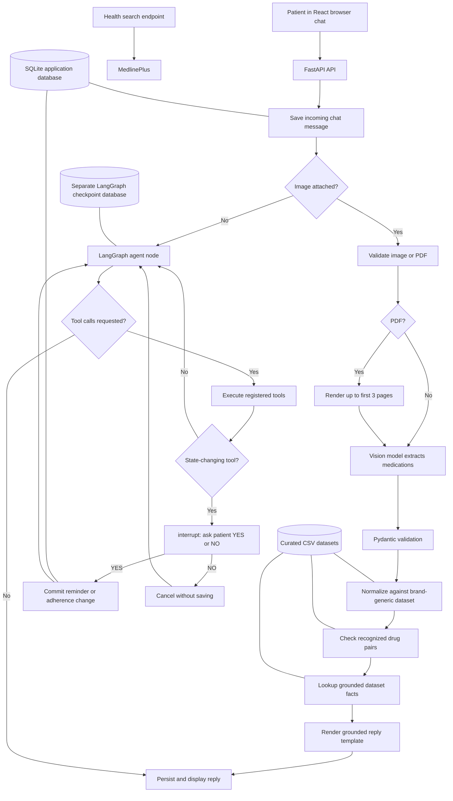

# MedBuddy
### A Browser-Based Medication Adherence & Drug-Interaction Assistant
**Project Documentation — current implementation**

| | |
|---|---|
| **Institution** | Kalinga Institute of Industrial Technology (KIIT University) |
| **Course** | Minor Project (5 credits) |
| **Team** | Prangshu [Roll No. 23052898] · Arundhati [Roll No. 23052873] |
| **Faculty Guide** | Prof. Lipika Mohanty |

> **Disclaimer:** MedBuddy is an academic proof-of-concept built for learning and demonstration. It is **not a certified medical device and must not be used for real clinical decision-making.** Medication and interaction information is limited to curated data, and the interface and medication-related responses display a proof-of-concept disclaimer.

---

## Executive Summary

> **For readers short on time — this section summarises the entire project.**

**MedBuddy** is a browser-based proof-of-concept medication assistant. It accepts prescription images and PDFs in a web chat, extracts medication details, checks recognized medicines against curated interaction data, and supports conversational reminders and adherence logging. It uses a hybrid LangGraph architecture: prescription images follow a fixed pipeline, while text turns use an LLM tool-use loop.

| Aspect | Summary |
|---|---|
| **What it is** | A React browser chat backed by a FastAPI medication-assistance API |
| **Target users** | Patients using a proof-of-concept medication assistant |
| **Key ideas** | Prescription processing is deterministic after extraction; drug and interaction claims are restricted to curated tool results |
| **Core flow** | Image/PDF → vision extraction → normalization → interaction check → grounded template reply; text → agent/tool loop |
| **Architecture** | Hybrid LangGraph implementation: fixed prescription path plus agentic text-chat path |
| **Tech stack** | React · FastAPI · LangGraph · LiteLLM · Gemini · SQLAlchemy · SQLite · curated CSV datasets |
| **Team / timeline** | 2 members (Prangshu, Arundhati) · KIIT 5-credit minor project |
| **Deliverables** | Working browser-chat proof-of-concept; evaluation metrics are intended to be measured and reported |
| **Status** | Proof-of-concept — **not for clinical use** |

**Current status:** the browser chat, API, hybrid agent flow, prescription pipeline, reminder confirmation, adherence logging, and health-information search are implemented. The app and its curated data are not clinically validated.

---

## 1. Abstract

Medication non-adherence and unnoticed drug-drug interactions can contribute to treatment problems. MedBuddy is a proof-of-concept browser chat that lets a patient upload a prescription image or PDF and receive extracted medication details, dataset-backed interaction findings, and a reminder prompt. The text-chat agent also supports patient profile registration, medication-list lookup, reminder proposals, and adherence logging.

The implemented architecture is hybrid: image submissions take a fixed prescription path, while non-image messages use an LLM-driven tool loop. This document describes the current implementation and its limitations; it does not treat earlier architecture options as future plans or implemented features.

---

## 2. Problem Statement & Motivation

- **Non-adherence is widespread.** The World Health Organization has noted that adherence to long-term therapies averages around 50% in developed countries, and is often lower in resource-constrained settings. Missed and mistimed doses reduce treatment effectiveness and increase avoidable complications.
- **Prescriptions are hard for patients to understand.** Medical shorthand, brand vs. generic naming, and handwriting make it difficult for a patient to know *what* they are taking and *why*.
- **Interactions go unnoticed.** Patients frequently take multiple medicines (and over-the-counter drugs) without any check for dangerous combinations.
- **Medication tools need an accessible interface.** MedBuddy explores a familiar browser-chat interface for submitting prescriptions and asking follow-up questions.
- **The assistant must communicate uncertainty.** Because extraction and curated-data coverage are limited, the system is designed to flag unknown medicines and avoid presenting missing interaction data as proof of safety.

---

## 3. Objectives

**Implemented capabilities**
1. Extract structured medication details (drug name, dosage, frequency, duration) from a photograph of a prescription.
2. Resolve known brand and generic names using the curated mapping dataset.
3. Check pairs of recognized medicines against the curated interaction dataset and report the stored severity and description.
4. Provide templated prescription results and a constrained optional rephrase mode.
5. Support profile registration, medication lookup, reminder proposals/confirmation, and taken/missed adherence logging through chat.
6. Provide MedlinePlus health-information search from the web interface.
7. Persist patient, prescription, reminder, adherence, chat, and conversation-checkpoint data.

---

## 4. Scope

**In scope**
- A phone number identifies a patient in the demo; this is not a full authentication or multi-tenant account system.
- A **static, curated** drug-interaction dataset and brand→generic mapping dataset.
- A browser-based React chat connected to a FastAPI backend.
- Proof-of-concept accuracy, with disclaimers throughout.

**Out of scope**
- Live FDA / WHO API integration — the interaction data is curated and static by design.
- Clinical-grade accuracy claims.
- Multi-tenant authentication or user-account management.
- WhatsApp/Twilio transport, a doctor-facing dashboard, or a clinical workflow.
- Tesseract OCR, a live FDA/WHO interaction integration, or a claim of comprehensive drug coverage.
- Snooze handling, missed-dose escalation, and recurring reminder scheduling.

---

## 5. System Overview — Core User Flow

1. The patient enters a phone number in the browser chat. The number is used as the patient identity; it is not secure account authentication.
2. The patient can provide a name and age through chat for profile registration.
3. The patient sends an image (JPEG, PNG, WebP) or PDF. The backend validates file type and size; PDFs are rendered as images for up to the first three pages.
4. An image is routed to a fixed pipeline. The vision model extracts medication name, dosage, frequency, duration, and optional source text into a schema-validated result.
5. Medication names are matched against the static brand/generic dataset; unmatched drugs are marked unknown.
6. Recognized generic names are checked pairwise against the interaction dataset.
7. The reply is built from extracted medication fields and interaction results. The default is a template; optional rephrase mode adds a second LLM call with constraints and a template fallback.
8. The patient may request reminders in a text conversation. A proposed state change is shown for explicit YES/NO confirmation before it is saved.
9. Due reminders are dispatched by the web chat's message-polling endpoint. The implementation schedules the next occurrence for each supplied time; it does not currently implement a recurring scheduler.
10. The patient can report a dose as **taken** or **missed**. The adherence log is written only after confirmation. Snooze and missed-dose escalation are not implemented.
11. Messages and application records are stored in SQLite; LangGraph conversation state is stored in a separate checkpoint database.

---

## 6. Technology Stack

| Layer | Technology |
|---|---|
| User interface / transport | React + TypeScript web chat; FastAPI HTTP API |
| Backend | FastAPI (Python) |
| Agent orchestration | LangGraph |
| LLM integration | LiteLLM; Gemini defaults configured by role (agent, vision, explanation) |
| Image extraction | Vision model directly reads the image; no Tesseract in the photo pipeline |
| Extraction validation | JSON parsing and Pydantic schema validation |
| Normalization | RapidFuzz matching against curated CSV data |
| Interaction engine | Python pairwise rule lookup over curated CSV data |
| Database | SQLAlchemy with SQLite by default |
| Conversation checkpointing | LangGraph SQLite checkpointer in a separate database |
| Health-information search | MedlinePlus search endpoint |
| Reminder dispatch | Due-reminder check on chat message polling; mockable clock for tests |

**Database models:** `patients`, `prescriptions`, `medications`, `interactions`, `reminders`, `adherence_logs`, and `chat_messages`. Conversation checkpoints are stored separately.

---

## 7. System Architecture

The current implementation is a **hybrid LangGraph application** with two entry routes. An incoming image is processed by a fixed prescription pipeline. A text message is handled by an LLM tool-use loop. This is the implemented architecture, not a proposal for a future phase.

### 7.1 Current methodology and data flow

In the default configuration, the image path makes one vision-model call for extraction. If `PHOTO_REPLY_MODE=rephrase` is enabled, an optional explanation-model call rewrites the already-rendered template; the template is used if rephrasing fails or omits required details. The separate `run_ocr` tool is available to the general agent, but the automatic image pipeline does not run a separate OCR/Tesseract stage.

### 7.2 Prescription image path

`route_entry` sends messages with a pending image to `prescription_node`. That node invokes the implementation in `medbuddy/agent/prescription.py`:

1. `extract_medications` sends the image directly to the configured vision model and validates the returned structure.
2. Each extracted name is normalized against the curated brand/generic dataset; results below the matching threshold remain unmatched.
3. Only matched generic names are included in pairwise interaction checks.
4. Drug lookup returns the dataset-backed identity information, or an unknown-drug disclaimer.
5. The final message is assembled from medication fields and interaction results. It does not claim that a combination is safe merely because no matching interaction was found.
6. Extracted medications are saved to the patient's prescription records.

The backend accepts JPEG, PNG, WebP, and PDF uploads subject to the configured size limit. PDFs are rendered as images for up to the first three pages; later pages are skipped with a chat notice.

### 7.3 Text conversation and tools

Text messages enter the LangGraph `agent_node` and `tool_node` loop. The LLM selects from the tools registered in `medbuddy/tools/__init__.py`:

- `run_ocr`
- `extract_medications`
- `normalize_drug`
- `check_interactions`
- `lookup_drug_info`
- `schedule_reminder`
- `log_adherence`
- `register_patient`
- `get_my_meds`

Conversation state is checkpointed per phone identity. The system prompt requires tool-grounded medication and interaction claims and tells the agent not to invent medicines or report an unlisted interaction.

### 7.4 State-changing confirmation

`schedule_reminder` and `log_adherence` are the state-changing tools. Before executing either, the graph pauses with LangGraph `interrupt()` and asks the patient to confirm. A YES response allows the tool to commit; a NO response cancels it without saving. The confirmation gate is implemented in application code rather than relying only on an LLM instruction.

Reminder times are interpreted using the configured fixed UTC offset (default: IST, UTC+05:30). The current implementation schedules the next occurrence for each supplied time. Due reminders are dispatched when the browser chat polls for messages; there is no APScheduler process or implemented daily recurrence. Adherence responses currently support only `taken` and `missed`.

### 7.5 Other application features

- **Patient profile:** the phone number is the patient identity. Name and age can be registered through chat; the phone login is not full authentication.
- **Chat persistence:** incoming and outgoing browser-chat messages are stored and retrieved through the API.
- **Health search:** the UI can query MedlinePlus through `/api/health-search`; this is separate from the curated dataset used for medication grounding.
- **Transport:** the React/Vite frontend uses the FastAPI web API. `FakeChannel` and the CLI are available for local development and tests.
- **LLM configuration:** LiteLLM is used with role-specific agent, vision, and explanation model settings; the configured defaults use Gemini.

### 7.6 Why hybrid rather than fully agentic

The photo workflow is fixed to keep its extraction, normalization, interaction lookup, and reply generation predictable and testable. The text workflow remains agentic so the model can select tools in response to questions and requests. A fully agentic photo workflow is not the current implementation.

---

## 8. Evaluation Methodology

The repository includes deterministic tests for normalization, interactions, prescription pipeline behavior, reminders, web API behavior, and agent orchestration. These test suites verify implementation behavior; they do not by themselves establish clinical accuracy or real-world effectiveness.

Recommended project evaluation measures, to be reported only when measured:

- **Extraction accuracy** — exact or normalized match for medication name, dosage, frequency, and duration against a manually labelled set of synthetic or anonymized prescription images.
- **Interaction lookup correctness** — expected findings and severity for labelled drug-pair test cases drawn from the curated dataset.
- **Reminder dispatch behavior** — whether a due reminder is emitted when the chat message endpoint is polled after its scheduled time.
- **End-to-end latency** — elapsed time from upload to the prescription response.

---

## 9. Constraints & Known Limitations

MedBuddy is an academic proof-of-concept and is **not suitable for clinical use**. Important limitations include:

- The brand/generic and interaction CSV files are small, static, curated datasets; absence of a match is not proof that a medicine or interaction does not exist.
- The interaction dataset includes 503 additional pair risk levels from the DDInter 2.0 ATC-A download, alongside existing sourced rows. These additions provide risk categories only, not pair-specific mechanisms or management advice, and are not a comprehensive or clinically validated checker. [DDInter 2.0 download](https://ddinter2.scbdd.com/download/)
- Prescription extraction can misread handwriting, image quality, or dosage details. The extracted result must be checked against the original prescription by a qualified professional.
- The vision model receives prescription images through an external LLM provider. Use synthetic or anonymized images for demonstrations and testing; do not upload sensitive patient data.
- The phone number is an identity key for the demo, not a verified login or complete security boundary.
- Medication lookup data is intentionally narrow. It does not provide comprehensive indications, contraindications, side effects, or individualized clinical advice.
- Reminder delivery is driven by browser chat polling and only schedules the next occurrence for supplied times; it is not a robust background scheduler or recurring notification service.
- The app does not implement snooze, missed-dose escalation, clinician review, or WhatsApp messaging.
- Health search uses MedlinePlus separately and is not a substitute for clinical advice.

The project has no clinical validation, regulatory certification, or claim of comprehensive safety.

---

## 10. Implementation Status

| Area | Current status |
|---|---|
| Browser chat | React/Vite frontend with phone-identity entry, chat polling, upload, and health-search UI |
| Web API | FastAPI endpoints for login, messages, typing state, media, and MedlinePlus search |
| Prescription images | Fixed vision extraction, schema validation, normalization, interaction lookup, and templated response |
| PDF input | First three pages rendered for image processing; extra pages are skipped with a notice |
| Text conversation | LangGraph LLM tool-use loop with registered patient, medication, interaction, reminder, and adherence tools |
| Confirmation | Reminder and adherence writes pause for patient YES/NO confirmation |
| Persistence | SQLAlchemy application records in SQLite by default; separate SQLite LangGraph checkpoint store |
| Tests | Component and integration-focused test modules are present for core tools, prescription pipeline, reminders, API, and orchestration |
| Not implemented | WhatsApp/Twilio transport, Tesseract OCR, APScheduler, daily recurring reminders, snooze, missed-dose escalation, dashboard, clinical validation |

---

## 11. Team & Responsibilities

| Member | Primary responsibilities | Secondary |
|---|---|---|
| **Prangshu** | Backend architecture, database schema, interaction rule engine, reminder logic, web API integration | Testing, deployment |
| **Arundhati** | OCR + LLM extraction pipeline, drug normalization, grounded explanation generation, evaluation metrics | Dataset curation, report writing |
| **Both** | Dataset curation, end-to-end integration testing, report and demo preparation | |

---

## 12. Expected Outcomes

- A working browser-chat proof-of-concept demonstrating prescription upload, medication extraction, normalization, interaction lookup, reminders with confirmation, and adherence logging.
- Deterministic tests for core components and API/agent behavior.
- An evaluation report may quantify extraction accuracy, interaction lookup correctness, reminder dispatch behavior, and response latency when measured against labelled test data.
- Documentation of the hybrid design, grounding constraints, and known limitations.

---

*MedBuddy — academic proof-of-concept. Not a certified medical tool; not for clinical use.*
